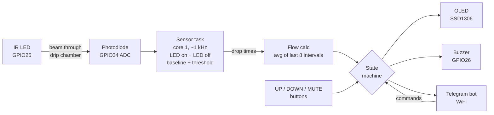

# IV Drip Monitor

[](https://github.com/cynicops/iv-drip-monitor/actions/workflows/ci.yml)

A low-cost IV drip flow-rate monitor built on an **ESP32**. An infrared LED and a photodiode clipped across the drip chamber count each falling drop. The ESP32 works out the flow rate in mL/hr, shows it on a 0.96" OLED, and sounds a buzzer and sends a **Telegram** alert when the drip **stops**, runs **too fast** or runs **too slow**.

This is our mini project for the **Sensors and Transducers** course (Mechatronics Engineering, MIT Manipal). The brief was a sensor-based tool that tackles a real-world problem.

> **Educational prototype only. This is not a medical device.** It has not been clinically validated and must not be used to make treatment decisions for real patients.

---

## Why

In crowded wards, one nurse can be watching many IV lines at once. Drips are still set by hand with a roller clamp and checked by counting drops against a watch. A line that has stopped (empty bag, kinked tube, clotted cannula) or that is running much too fast can go unnoticed for a long time. Commercial infusion pumps solve this, but they cost far more than most general wards can afford per bed. This monitor clips onto the drip chamber that is already in use and raises an alarm by itself.

## Features

- Counts drops optically. The IR LED is pulsed and the ambient reading is subtracted, so room light and tube-light flicker are cancelled out.
- Live flow rate (mL/hr), drops/min, volume infused and estimated time until the bag is empty.
- Alarms for **FLOW STOPPED**, **TOO FAST** and **TOO SLOW** (more than ±20 % off target for 30 s). The buzzer beeps and a Telegram message is sent, with a reminder every 2 minutes.
- A "bag low" warning when 10 % of the bag is left.
- Three buttons: **UP**/**DOWN** set the target rate. A short press of **MUTE** silences the buzzer for 2 min. Holding **MUTE** for 2 s means "new bag" and resets the volume counter.
- Telegram commands: `/status`, `/mute`, `/setrate`, `/setbag`, `/dropfactor`.
- Keeps working **offline**. If WiFi drops, the local buzzer alarm still works and the board reconnects every 30 s.
- A dedicated FreeRTOS sensor task samples about 1000×/s, so slow Telegram calls never cause missed drops.
- **Calibration mode** streams the raw sensor signal to the Arduino Serial Plotter so the sensor can be aligned.

## How it works



```
flow (mL/hr) = drops per minute × 60 / drop factor
```

The drop factor is printed on the IV set: **20 drops/mL** for a standard adult (macro) set and **60 drops/mL** for a micro set. Some sets are 10 or 15.

Full details are in [docs/HOW_IT_WORKS.md](docs/HOW_IT_WORKS.md).

## Hardware

| Part | Qty | Notes |
|---|---|---|
| ESP32 DevKit (ESP32-WROOM-32) | 1 | "ESP32 Dev Module" in Arduino IDE |
| IR LED, 940 nm, 5 mm | 1 | |
| IR photodiode, 5 mm (e.g. BPW34 / generic 940 nm) | 1 | used reverse-biased |
| 0.96" SSD1306 OLED, I2C, 128×64 | 1 | address 0x3C |
| Active buzzer module (3-pin) | 1 | |
| Push buttons | 3 | UP, DOWN, MUTE |
| Resistors 100 Ω, 100 kΩ | 1 each | |
| Breadboards (2 joined) + jumper wires | | |
| Opaque clip/housing for the drip chamber | 1 | holds LED and photodiode facing each other |

### Wiring

| From | To |
|---|---|
| GPIO25 → 100 Ω → IR LED anode (long leg) | IR LED cathode → GND |
| Photodiode cathode (short leg) → 3V3 | Photodiode anode (long leg) → GPIO34, and 100 kΩ from GPIO34 → GND |
| OLED SDA → GPIO21, SCL → GPIO22 | OLED VCC → 3V3, GND → GND |
| Buzzer I/O → GPIO26 | Buzzer VCC → 3V3, GND → GND |
| UP button → GPIO32 | other leg → GND (internal pull-up) |
| DOWN button → GPIO33 | other leg → GND |
| MUTE button → GPIO27 | other leg → GND |

The circuit diagram notes, assembly tips and mounting on the drip chamber are in [docs/HARDWARE.md](docs/HARDWARE.md).

## Quick start

1. Install **Arduino IDE 2**, add the ESP32 board package (Espressif `esp32`, tested with 3.3.12) and install the libraries **Adafruit SSD1306**, **Adafruit GFX**, **UniversalTelegramBot** and **ArduinoJson**.
2. Create a Telegram bot with **@BotFather** and find your chat ID.
3. Open [`firmware/IV_Drip_Monitor/IV_Drip_Monitor.ino`](firmware/IV_Drip_Monitor/IV_Drip_Monitor.ino) and fill in `WIFI_SSID`, `WIFI_PASS`, `BOT_TOKEN` and `CHAT_ID`.
4. Select **ESP32 Dev Module**, choose the COM port and click **Upload**.
5. Align the sensor using calibration mode, then set `CALIBRATION_MODE = false` and upload again.

Step-by-step instructions, including Telegram setup and calibration, are in [docs/SETUP.md](docs/SETUP.md).

> ⚠️ **This repository is public.** Never commit your real WiFi password or bot token. Keep the placeholders in the repo and enter your real values only in your local copy.

## Using it

**Screen**

```
Set 100 mL/h          WiFi
100            mL/h
33.3 dpm  42/500mL
Flow normal
```

The bottom bar turns inverted (white) during an alarm and shows `(mute)` while the buzzer is muted.

**Buttons**

| Button | Press | Hold 2 s |
|---|---|---|
| UP | target +5 mL/hr (max 500) | same, once |
| DOWN | target −5 mL/hr (min 5) | same, once |
| MUTE | silence buzzer for 2 min | **new bag**: reset volume counter (and mute) |

**Telegram**

| Command | Effect |
|---|---|
| `/status` (or `/start`) | state, flow, target, drops/min, volume, time to empty |
| `/mute` | silence the buzzer for 2 minutes |
| `/setrate 100` | set target rate (5–500 mL/hr) |
| `/setbag 500` | new bag of this volume (50–3000 mL), resets the counter |
| `/dropfactor 20` | set the IV set's drop factor (10, 15, 20 or 60) |

Only messages from `CHAT_ID` are accepted. Messages from anyone else are ignored.

## Repository layout

```
firmware/IV_Drip_Monitor/IV_Drip_Monitor.ino   ESP32 firmware (the whole project)
test/                                          host-side test suite (runs on a PC)
  mocks/                                       fake Arduino/ESP32/WiFi/Telegram/OLED APIs
  harness.h                                    simulated drip chamber + scheduler
  test_main.cpp                                75 tests
  mutation_check.sh                            checks that the tests catch injected bugs
docs/                                          setup, hardware, theory and test report
.github/workflows/ci.yml                       compiles for ESP32 + runs all tests on every push
```

## Testing

All tests run automatically on GitHub Actions on every push:

| Check | Result |
|---|---|
| ESP32 compile (`esp32:esp32:esp32`, core 3.3.12, `--warnings all`) | ✅ no warnings in the sketch · flash 81 % (1.07 MB) · RAM 15 % |
| Host test suite: the unmodified sketch running against a simulated drip chamber | ✅ **75 / 75 passed** |
| Mutation check: 12 deliberately injected bugs | ✅ **12 / 12 caught** |

The tests cover drop detection under noise, flicker, drift and bumps; flow accuracy from 10 to 500 mL/hr with 10/15/20/60 drop sets (all within 1 %); every alarm and its timing; buttons including debounce; all Telegram commands; WiFi loss and reconnect; the display; and `millis()` wrap-around. The tests found one real bug: after about 24.8 days of uptime the buzzer would stay silent during alarms. It has been fixed (see [CHANGELOG.md](CHANGELOG.md)).

Full report, measured limits and a bench-test checklist for the real hardware: [docs/TESTING.md](docs/TESTING.md).

Run the tests yourself (Linux, macOS or WSL, needs `g++` and `make`):

```bash
make -C test          # build and run everything
make -C test report   # also writes test/build/test-results.md
test/mutation_check.sh
```

## Known limitations

- Above about **480 drops/min** (drops less than 120 ms apart) some drops are missed. With a 60 drops/mL micro set, keep the rate below about 480 mL/hr. In practice micro sets are only used for slow rates.
- Very strong flickering light falling directly on the photodiode, or a very noisy ADC, can cause false counts. Use an opaque housing. Measured limits are in [docs/TESTING.md](docs/TESTING.md).
- Volume is estimated from drop count × nominal drop size. Real drop size changes with the fluid, the temperature and the set, typically by ±10 %.
- If the chamber is bumped, the sensor sees one extra drop and then recovers on its own.
- Alerts that occur while WiFi is down are not queued. They reach Telegram through the 2-minute reminder once the connection is back.
- Telegram commands with a bot suffix (e.g. `/status@MyBot` in group chats) are not recognised. Send the plain command.

## License

[MIT](LICENSE)
