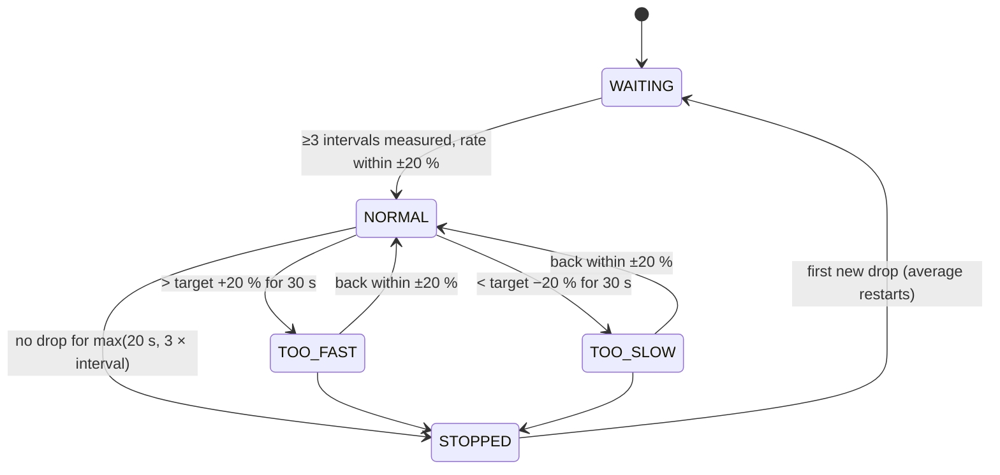

# How it works

## 1. Sensing principle

The IR LED and the photodiode sit on opposite sides of the transparent drip chamber. With no drop present, a steady amount of IR reaches the photodiode. When a drop falls through the beam, it refracts and scatters the light. For the few milliseconds the drop takes to pass, the photodiode current changes, usually downwards. The photodiode works as a **light-to-current transducer**, and the 100 kΩ load resistor converts that current into a voltage the ESP32's 12-bit ADC can read.

## 2. Cancelling room light: synchronous detection

Room light, sunlight and 100 Hz flicker from tube lights also reach the photodiode, and they are often stronger than the LED. The sensor task therefore takes two readings about 150 µs apart for every sample:

```
LED ON  → wait 150 µs → read  onVal   (LED + ambient)
LED OFF → wait 150 µs → read  offVal  (ambient only)
signal = onVal − offVal               (LED only)
```

Ambient light hardly changes in 150 µs, so it cancels in the subtraction. The test suite shows no false counts with 300 ADC counts of 100 Hz flicker, compared with a threshold of 60 ([TESTING.md](TESTING.md#characterisation-measured-limits)).

## 3. Detecting a drop

```
           baseline (slow average of signal when no drop)
 signal ─────────────╮      ╭──────────────────────────
                     │      │
          threshold ─│──────│─── baseline − 60
                     ╰──────╯
                     ↑ drop detected (time stamped)
```

- **Baseline:** an exponential moving average, `baseline += 0.002 × (signal − baseline)`, updated only while no drop is in the beam. At about 770 samples/s its time constant is about 0.65 s. It follows slow changes such as LED warm-up, temperature drift or a change in ambient light, but it does not react to a drop.
- **Trigger:** a drop is counted when `|signal − baseline| > DETECT_THRESHOLD` (60 counts). The absolute value catches both darkening and brightening drops.
- **Refractory period:** after a trigger, nothing else is counted for 120 ms. This stops a splash or wobble from being counted twice. It also sets the upper limit of about 480 drops/min.
- **Drop end:** the drop is over once the signal is back within half the threshold of the baseline.
- **Re-learn:** if the signal stays shifted for more than 300 ms, the clip has moved and this is not a drop. The baseline is reset to the new level. A bump like this costs one extra count, and detection then continues normally.

All of this runs in a **FreeRTOS task pinned to core 1** at priority 2, sampling about every 1.3 ms. Drop times are written to a ring buffer of the last 8 intervals inside a `portENTER_CRITICAL` section. `loop()` reads them the same way. Telegram calls can block `loop()` for a second or more, but they never delay sampling. The tests check this with 800 ms of simulated network latency per call.

## 4. From drops to flow rate

```
avg_interval  = mean of the last up to 8 drop-to-drop intervals (needs ≥ 3)
drops/min     = 60 000 / avg_interval_ms
flow (mL/hr)  = drops/min × 60 / DROP_FACTOR
infused (mL)  = drops since "new bag" / DROP_FACTOR
remaining     = bag volume − infused          (never below 0)
time to empty = remaining / flow  (hours)
```

Example: a 20 drops/mL set dripping every 1.8 s gives 33.3 drops/min, so 33.3 × 60 / 20 = **100 mL/hr**.

The common drop factors (drops per mL) are 10, 15 and 20 for macro sets and 60 for micro (paediatric) sets. Averaging 8 intervals smooths out normal drop-to-drop jitter. After the clamp is changed, the reading settles within 8 drops.

## 5. Alarm state machine



| Event | Buzzer | Telegram |
|---|---|---|
| enter STOPPED / TOO_FAST / TOO_SLOW | 200 ms beep every second | `ALARM: …` + full status |
| alarm still active | keeps beeping | `REMINDER: …` every 2 min |
| alarm cleared | stops | `Resolved.` + status |
| < 10 % of bag left | — | `Bag low: about N mL left` (once per bag) |
| MUTE (button or `/mute`) | silent for 2 min | `Buzzer muted for 2 minutes.` (when sent from Telegram) |

Design choices:

- **The stop timeout scales with the drip.** At very slow rates (e.g. 20 mL/hr, one drop every 9 s) a fixed 20 s timeout would cause false alarms. The timeout is therefore `max(20 s, 3 × average interval)`.
- **30 s grace period** for fast/slow, so a brief bump of the clamp or the patient moving their arm does not trigger an alarm.
- **No STOPPED alarm before flow is established.** A single stray trigger at start-up (someone touching the clip) cannot cause an alarm.
- **After a stop the average restarts.** The long gap is not mixed into the new rate.
- **Muting is tracked with a flag**, not just a timestamp, so it stays correct when `millis()` wraps. See the bug fixed in [CHANGELOG.md](../CHANGELOG.md).

## 6. Software structure

| Function | Runs | Job |
|---|---|---|
| `sensorTask()` | own task, core 1, every ~1.3 ms | LED pulsing, baseline, drop detection, interval ring buffer |
| `updateFlow()` | `loop()` | rate, volume, state machine |
| `updateAlarms()` | `loop()` | buzzer pattern, Telegram alarm/reminder/resolved/bag-low |
| `handleButtons()` | `loop()` | debounced (30 ms) short/long press |
| `handleTelegram()` | `loop()`, every 3 s | poll and answer commands (only from `CHAT_ID`) |
| `drawScreen()` | `loop()`, every 200 ms | OLED |
| WiFi reconnect | `loop()`, every 30 s while offline | |

Telegram uses HTTPS with Telegram's root certificate (`TELEGRAM_CERTIFICATE_ROOT`). `USE_INSECURE_TLS` is a debugging escape hatch only.
